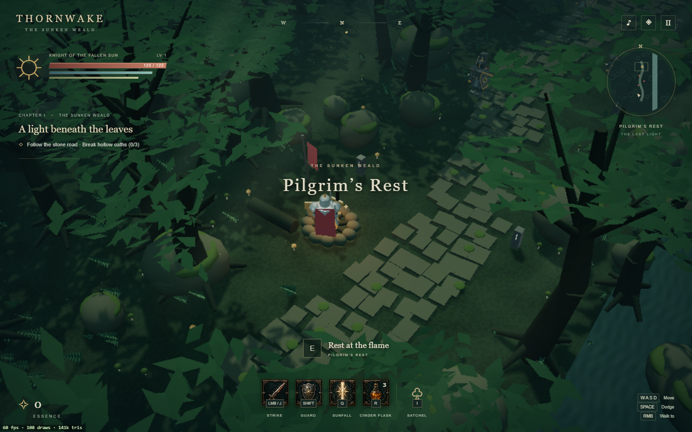

# THORNWAKE — The Sunken Weald

A complete, small desktop browser chapter built with TypeScript, Three.js, and Vite. All world geometry, character rigs, animation, atmosphere, water, and sound are procedural. The interface uses a single generated icon atlas. No models, remote fonts, CDN scripts, or downloaded texture packs are needed at runtime.



[Watch the 1080p trailer](cinematic/Thornwake_Trailer.mp4) | [Inspect the inventory](docs/screenshots/inventory.png)

## Play

Requires Node.js 22.12+ (or a current LTS release), npm, and a WebGL 2 browser. No environment variables or API keys are required to play.

```sh
npm install
npm run dev
```

Open http://localhost:5173 and choose **Enter the weald**. WebGL 2 is required. The game targets desktop keyboard and mouse.

| Control | Action |
|---|---|
| WASD / arrows | Screen-relative movement |
| Mouse | Face the pointer |
| Left mouse / J | Strike; three consecutive strikes form a combo |
| Right mouse | Walk toward a ground point |
| Space | Dodge roll; costs endurance, grants brief invulnerability |
| Shift / K | Hold directional shield guard |
| Q | Sunfall area spell; costs 25 essence |
| R | Drink a cinder flask |
| E | Rest at the campfire / kindle the final altar |
| I / Tab | Inventory, inspect, equip and unequip |
| Escape | Pause or close a panel |

The HUD buttons also trigger actions; hold the guard icon to block. The music note toggles synthesized audio and the diamond toggles shadow quality. The game pauses when its window loses focus.

## Chapter route

Rest at **Pilgrim’s Rest**, then follow the stone road north. Break three hollow oaths, inspect the recovered falchion, and return to the fire if you want to spend earned essence on a level. The **Wealdkeeper** awakens after all three wardens fall. Dodge the marked attacks, strike during recovery, and kindle the altar after defeating the keeper. Both defeat and victory offer a fresh restart.

Six inventory items, four equipment slots, attribute bonuses, three flasks, and rest-point leveling are implemented. Session progress is held in memory and resets on reload. This is a self-contained first chapter, not an open-world campaign.

## Build and verify

```sh
npm test
npm run build
npm run preview
```

`dist/` is the entire deployable game. Serve it over HTTP; opening an ES-module build directly as a local file is unsupported. The build uses relative paths and can be hosted under a subdirectory. The Blender runtime, source scene, and trailer are separate production artifacts and are not copied to `dist/`.

The simulation runs at a fixed 60 Hz. Static geometry is merged by material; rigid armor plates are merged within animated limbs. The forest shadow map is cached. An adaptive render scale targets 60 fps, preserving full-resolution HTML UI; actual performance depends on hardware. The final browser check measured 60 fps on Intel UHD graphics with adaptive resolution (108 draw calls in the camp scene). The day-to-night lighting cycle lasts about eight minutes. Canopy cutaway keeps the knight visible through foreground trees.

Append `?dev=1` to show frame rate, draw calls, and triangle count. This also exposes `window.__thornwake` for inspection, deterministic state setup, and scene export. It is disabled by default.

`tests/game.test.ts` tests combat costs and cooldowns, directional guard, invulnerability, equipment ownership, leveling, the chapter gates, defeat, and restart. `tools/smoke.mjs` checks the browser screens, inputs, terminal flows, console errors, and exports the scene. To run the browser checks, install the test browser with `npx playwright install chromium`, start the development server, then run `node tools/smoke.mjs`. Set `PLAYWRIGHT_CHANNEL=chrome` to use an installed Chrome browser instead. The smoke test also verifies keyboard attacks and immediate quest updates after resting. Boss and terminal-state setup in the browser smoke test is deliberate, while combat rules are tested independently.

## Project structure

- `src/game.ts`: fixed-step combat and progression rules.
- `src/world.ts`: procedural geometry, animation, camera, and lighting.
- `src/ui.ts`, `src/style.css`: HUD, inventory, and menus.
- `src/main.ts`, `src/audio.ts`: input, render loop, and synthesized audio.
- `tests/` and `tools/`: gameplay tests, browser checks, and the 2 MB build budget.
- `design/`: visual direction and generated icon prompt.
- `cinematic/`: Blender reconstruction scripts and the finished trailer.

## Blender and trailer

The MP4 is included in this repository. The following `.blend` files are generated locally by the scripts and are excluded from Git, along with the Blender runtime, intermediate scene export, and rendered frames. Use Blender 4.3.2 for the supplied video-sequencer API.

- `cinematic/Thornwake.blend`: the complete procedural forest, camp, road, ruins, knight, and guardian, recreated from the game's actual geometry with cinematic lighting, material microdetail, mist, depth of field, and a three-shot camera timeline.
- `cinematic/Thornwake_Trailer.mp4`: a 12-second 1920×1080 trailer assembled from three Blender-rendered shots, with slow reframing, fades, original synthesized music, title and tagline.
- `cinematic/Trailer_Edit.blend`: the editable video sequence.

Rebuild the scene export with the browser smoke script, then run:

```sh
blender --background --python cinematic/build_trailer.py -- --stills
blender --background --python cinematic/assemble_trailer.py
```

Use `--cycles` for path-traced stills. The default is Eevee. `--resume` preserves existing rendered shots. `--animate` renders the native 288-frame 3D camera timeline instead of the still-based edit. The delivered edit deliberately uses still shots of the standing knight with animated reframing; it is not a character-animation film.

The icon atlas at `public/assets/icons.webp` was generated with the built-in image tool and optimized to 194 KB. Its prompt is in `design/icon-prompt.txt`. Three.js is MIT licensed; the license is included in the build.

## License

The project code is available under the [MIT license](LICENSE). Three.js retains its own MIT copyright notice in `public/THIRD_PARTY_NOTICES.txt`. The icon atlas was AI-generated; no third-party model or texture packs are bundled.
